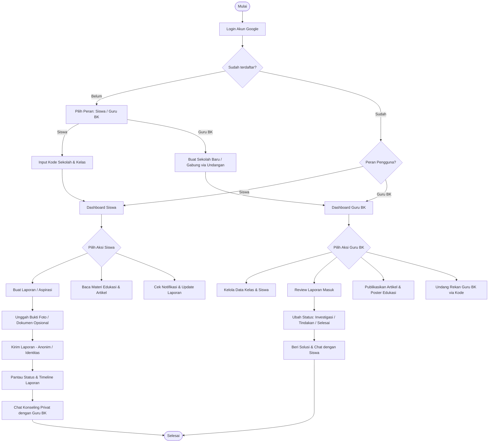
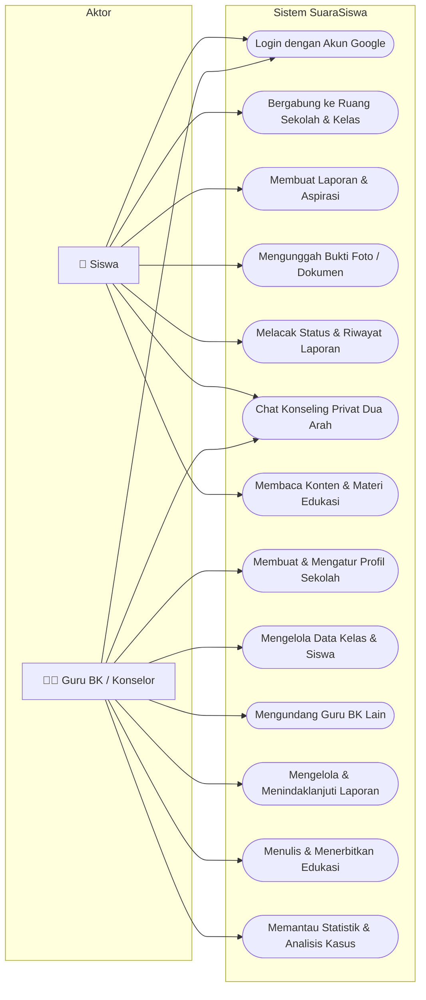
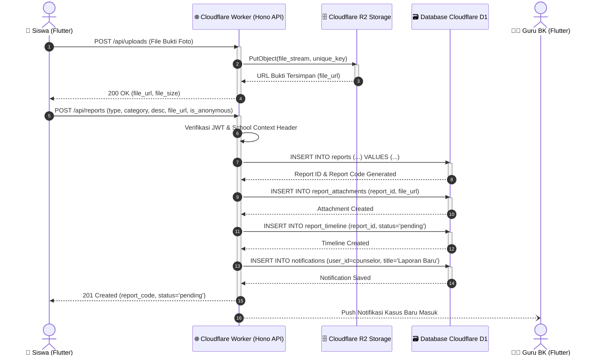
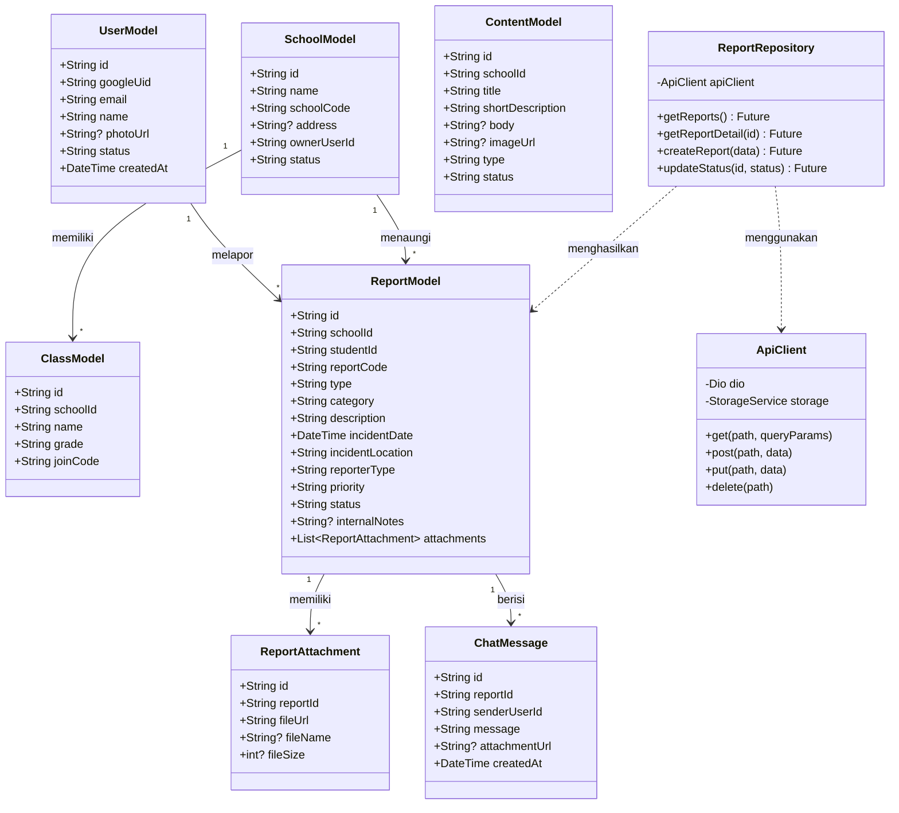
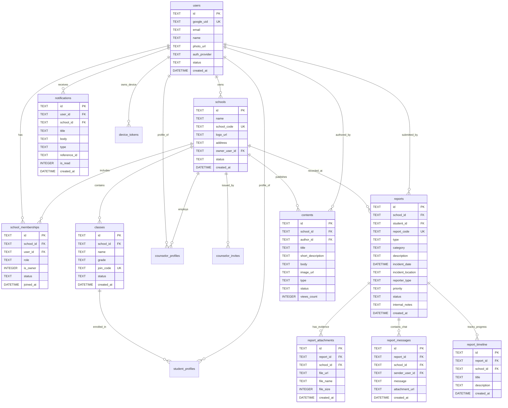
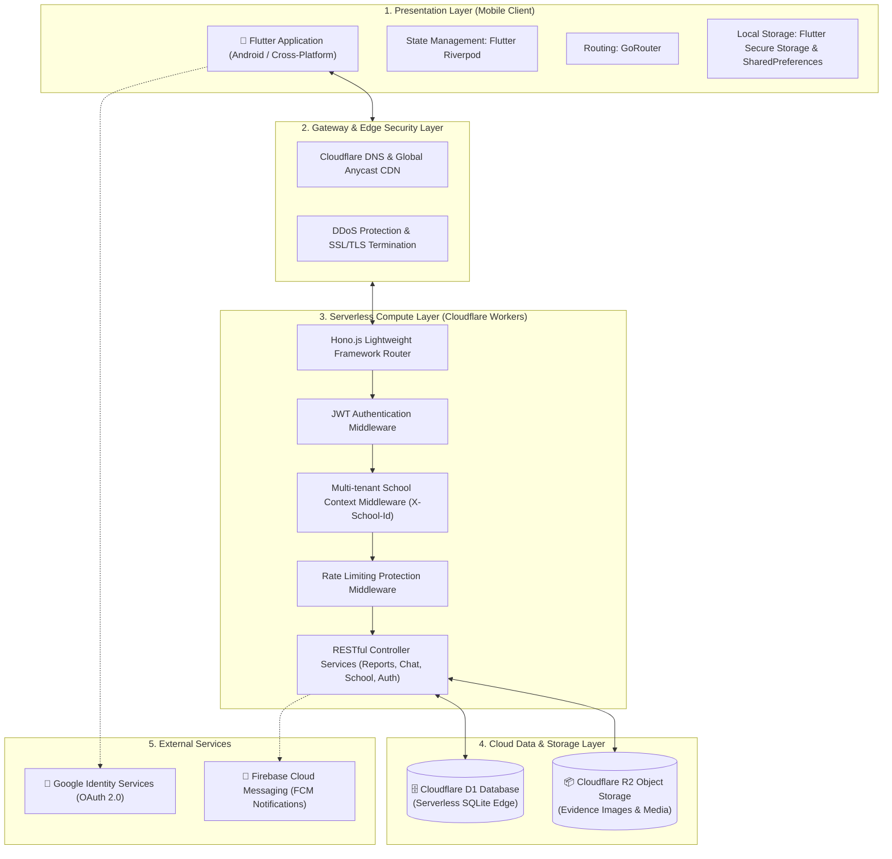

# 🏫 SuaraSiswa — Platform Pengaduan & Bimbingan Konseling Sekolah

> *"Berani bersuara, bersama mencari solusi."*

SuaraSiswa adalah platform **SaaS Mobile Application** berbasis **Flutter** dan **Cloudflare Serverless Stack** yang dirancang untuk menjembatani komunikasi aman dan rahasia antara **Siswa** dan **Guru BK (Bimbingan & Konseling)** di lingkungan sekolah. Aplikasi ini mendukung penanganan kasus perundungan (*bullying*), penyampaian aspirasi, kritik & saran, chat privat terenkripsi, pelacakan status penanganan laporan secara transparan, serta edukasi siswa.

---

## 📑 Daftar Isi Dokumentasi Sistem

Sesuai standar rekayasa perangkat lunak, dokumentasi teknis sistem dirangkum dalam tabel berikut:

| No. | Dokumentasi | Fungsi |
|---|---|---|
| 1 | [Flowchart Sistem](#1-flowchart-sistem) | Menggambarkan alur kerja aplikasi secara menyeluruh |
| 2 | [Use Case Diagram](#2-use-case-diagram) | Menggambarkan interaksi aktor (Siswa & Guru BK) dengan sistem |
| 3 | [Activity Diagram](#3-activity-diagram) | Menggambarkan aktivitas mendalam pada alur fitur utama |
| 4 | [Sequence Diagram](#4-sequence-diagram) | Menggambarkan komunikasi antar komponen teknis aplikasi |
| 5 | [Class Diagram](#5-class-diagram) | Menggambarkan struktur kelas dan relasi data aplikasi |
| 6 | [ERD (Entity Relationship Diagram)](#6-erd-entity-relationship-diagram) | Menggambarkan struktur dan relasi database relasional D1 |
| 7 | [Arsitektur Sistem](#7-arsitektur-sistem) | Menjelaskan hubungan Frontend, Backend Edge, dan Database |

---

## 1. Flowchart Sistem
Menggambarkan alur kerja pengguna mulai dari autentikasi Google, pemilihan peran, pendaftaran sekolah/kelas, hingga siklus pelaporan dan konseling.



---

## 2. Use Case Diagram
Menggambarkan fungsionalitas sistem yang dapat diakses oleh masing-masing aktor (**Siswa** dan **Guru BK**).



---

## 3. Activity Diagram
Menggambarkan urutan aktivitas detail pada proses **Pengiriman & Penanganan Laporan Pengaduan**.

```mermaid
flowchart TD
    subgraph Siswa
        A1[Buka Formulir Laporan] --> A2[Pilih Kategori: Bullying / Saran / Aspirasi]
        A2 --> A3[Tentukan Visibilitas: Nama Asli / Anonim]
        A3 --> A4[Tulis Deskripsi, Tanggal, dan Lokasi]
        A4 --> A5[Lampirkan Bukti Foto/File]
        A5 --> A6[Klik Kirim Laporan]
    end

    subgraph "Sistem Backend (Cloudflare Worker & D1)"
        A6 --> B1[Validasi Token JWT & Input Data]
        B1 --> B2[Simpan File Bukti ke Storage R2]
        B2 --> B3[Simpan Record Laporan ke Database D1]
        B3 --> B4[Generate Nomor Laporan Unik]
        B4 --> B5[Buat Log Timeline Awal: Laporan Diterima]
        B5 --> B6[Kirim Push Notification ke Guru BK]
    end

    subgraph "Guru BK"
        B6 --> C1[Terima Notifikasi Laporan Masuk]
        C1 --> C2[Buka Detail Laporan & Periksa Bukti]
        C2 --> C3[Ubah Status: Sedang Diinvestigasi]
        C3 --> C4[Buka Ruang Chat Privat Laporan]
        C4 --> C5[Kirim Pesan Pendampingan ke Siswa]
    end

    subgraph Penyelesaian
        C5 --> D1[Siswa Membalas Pesan Chat]
        D1 --> D2[Pertemuan / Tindakan Nyata di Sekolah]
        D2 --> D3[Guru BK Mengubah Status: Selesai / Ditindaklanjuti]
        D3 --> D4[Sistem Menandai Status Akhir Laporan]
    end
```



---

## 4. Sequence Diagram
Menggambarkan interaksi antar objek sistem (*Mobile Client*, *API Gateway*, *Database D1*, dan *Storage R2*) saat Siswa mengirimkan laporan dengan bukti.



---

## 5. Class Diagram
Menggambarkan relasi antara Model Data inti dan Arsitektur Repository pada aplikasi Flutter.



---

## 6. ERD (Entity Relationship Diagram)
Skema relasional database **Cloudflare D1** (SQLite Relational Edge Engine).



---

## 7. Arsitektur Sistem
Menjelaskan arsitektur perangkat lunak berbasis Cloud Native Serverless:



---

## 🚀 Panduan Memulai (Getting Started)

### Prasyarat
* Flutter SDK (versi >= 3.22.0)
* Android SDK / Android Studio
* Node.js (versi >= 18.0.0) untuk pengelolaan backend Cloudflare

### 1. Menjalankan Aplikasi Mobile (Flutter)
```bash
# Clone repository
git clone https://github.com/wahyuhidayatwyh-boop/APK-suarasiswa.git
cd APK-suarasiswa

# Install dependencies
flutter pub get

# Jalankan aplikasi di emulator atau device
flutter run
```
*Aplikasi secara default sudah otomatis terhubung ke backend live yang aktif.*

### 2. Menjalankan Backend Lokal (Cloudflare Worker)
```bash
# Masuk ke direktori worker
cd worker

# Install dependencies
npm install

# Buat file rahasia lokal .dev.vars
cp .dev.vars.example .dev.vars

# Terapkan skema database lokal
npx wrangler d1 migrations apply DB --local

# Jalankan server lokal
npm run dev
```

---

## 🔒 Keamanan & Privasi
* **Privasi Siswa Terjamin**: Siswa dapat memilih untuk melapor sebagai **Anonim**. Identitas siswa disamarkan pada antarmuka Guru BK.
* **Terenkripsi**: Komunikasi data menggunakan protokol HTTPS/TLS dan autentikasi berbasis stateless JWT token.
* **Isolasi Multi-Tenant**: Akses antar sekolah diisolasi melalui validasi `X-School-Id` pada header setiap request API.

---

## 📄 Lisensi
Hak Cipta © 2026 **SuaraSiswa Project**. Dilindungi undang-undang.
